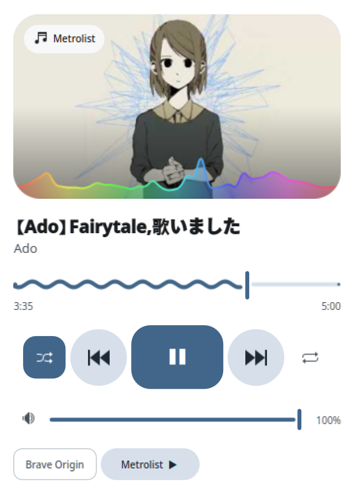

# Wave Player

A Plasma 6 panel widget that combines
[PlasMusic Toolbar](https://github.com/ccatterina/plasmusic-toolbar) and
[Kurve](https://github.com/luisbocanegra/kurve) (formerly Plasma Audio Visualizer).
The panel shows a rounded pill with the album art, title, and a play button.
A CAVA visualizer is drawn behind it. The part of the wave left of the playhead
is darker, so the wave also works as the progress bar. The popup uses Material 3
Expressive styling with colors from the album art.


<p align="center">
  
</p>

The widget picks the player itself instead of using Plasma's multiplexer row,
which can stay stuck on an old player. A playing player wins. Otherwise the
player that was active most recently wins. Players without metadata, such as
idle browser tabs, are ignored. The chips at the bottom of the popup pin a
player until another one starts playing.

## Requirements

- Plasma 6
- `cava`
- Python 3 with `websockets`
- [`just`](https://github.com/casey/just) for the recipes below

## Install

```sh
git clone https://github.com/Uzuki-P/plasma-wave-player.git
cd plasma-wave-player
just install
```

Then right-click the panel, choose "Add or Manage Widgets", and add Wave Player.
Run `just reload` after pulling updates so plasmashell loads the new code.

## Recipes

| Recipe | What it does |
| --- | --- |
| `just install` | Installs the widget and its icon, or upgrades the installed copy |
| `just reload` | Runs `just install`, then restarts plasmashell so the panel loads the new code |
| `just dev` | Runs the widget in its own window |
| `just snapshot [--display] [dir]` | Saves `compact.png` and `full.png`. `--display` renders on the Wayland session so the rounded art mask shows. |
| `just uninstall` | Removes the installed package and icon |

## How the visualizer runs

CAVA only runs while something is playing. `contents/tools/cava-bridge` runs
CAVA and streams its frames to the widget over a local WebSocket with a
per-run token. It exits when the widget closes the socket.

## Credits

Wave Player builds on two Plasma widgets:

- [PlasMusic Toolbar](https://github.com/ccatterina/plasmusic-toolbar) by
  ccatterina, for the MPRIS player controls in the panel.
- [Kurve](https://github.com/luisbocanegra/kurve) by Luis Bocanegra, formerly
  Plasma Audio Visualizer, for the CAVA visualizer and its WebSocket bridge.

## License

[GPL-3.0](LICENSE)
